# Optimizing VMD with over 170 intelligent algorithms using Python code, five fitness functions can be switched at will, various indicators calculated and plotted in one article!

In this issue, we utilize the powerful Python library, mealpy, to optimize VMD parameters.
The mealpy library contains over 170 intelligent optimization algorithms, including both original and improved versions. For a detailed introduction to the mealpy library, please refer to this link: https://mealpy.readthedocs.io/en/latest/
The five fitness functions are: minimum entropic embedding, sample entropy, information entropy, permutation entropy, and permutation entropy/mutual information entropy. The introduction to these five fitness functions has been extensively covered before; you can refer to the following links for further information:
① Why VMD needs to optimize parameters, such as minimum entropies/sample entropy/permutation entropy/information entropy, and which fitness function should be selected?
② The running speed has finally improved! Optimize VMD parameters, switch between five fitness functions freely, minimum entropies: sample entropy, information entropy, permutation entropy, permutation entropy/mutual information entropy.
Python code example:
Step 1: Read data.
import scipy.io as scio
The data used is from X105_DE_time data of Case Western Reserve University (CWRU), which is a (N*1) data. This also means that as long as your data is in one column, it can be easily replaced!
Step 2: Define the fitness function
from objectfun import EnvelopeEntropyCost, SampleEntropyCost, PermutationEntropyCost, infoEntropyCost, compositeEntropyCost
ObjectFun is a five-function fitness definition written by the author. When called in the main program, it can conveniently call these five fitness functions! The five fitness functions are: minimum entropic embedding, minimum sample upper bound, minimum permutation entropy, minimum information entropy, and composite indicator: permutation entropy/mutual information.
Step 3: Call the mealpy library to optimize VMD parameters.
problem_dict = {
Pay attention to the comments above the code, and clearly understand how to conveniently modify the fitness function!
Question: How to call different intelligent algorithms?
Simply call the algorithm name at the beginning of the program and then replace it with this algorithm name in the program!
For example:
from mealpy import EOA, GWO, BBO, BMO, EOA, IWO, TPO
Question: How can I know which algorithms are available in the mealpy library to be called?
It's quite simple, just type a command in the terminal:
Open this location, find the meaply folder, and click into it:
Here are various algorithms, you can click on any one to enter, for example, I click on the first bio_based:
The names of the algorithms are all here, and then you can call these algorithms in your program!
Let's take a look at the final results:
Example 1
This is the Harris Hawk Optimization (HHO) and Frost-Ice Algorithm (RIME), with the fitness function being the result of minimizing entropic envelope:
After running, the following result will be displayed in the command line window:
The first parameter is the optimal penalty factor alpha, and the second is the mode component K.
Example 2
I must say, the algorithm for modifying is really convenient!
Another multiverse algorithm (MVO) and zebra algorithm (ZOA), with the fitness function being the result of minimizing arrangement entropy:
Expanded functionality!
This issue's code not only has the function of optimizing VMD parameters but also allows for the backtracking of the optimal parameters into VMD after optimization, thereby enabling the generation of VMD decomposition diagrams, envelope curves, envelope spectra, spectral diagrams, center frequency, kurtosis, energy entropy, sample entropy, fuzzy entropy, permutation entropy, approximate entropy, and envelop entropy.
For example, in Example 1, the optimal parameters were calculated to be: alpha = 647, K = 4.
At this point, directly feed these two parameters back and then generate an image with a single click and count various indicators. The results are as follows:
VMD decomposition diagram:
VMD decomposition of 3D graphs:
Envelope line chart:
Envelope spectrum:
Skewness Plot:
Spectrum chart:
Printing of various indicator calculation results:
Code Directory
The required package version is as follows:
numpy~=1.26.3\nscipy~=1.12.0\nmatplotlib~=3.8.2\nmealpy~=2.5.3\nvmdpy~=0.2\nscikit-learn~=1.4.0\npandas~=2.2.0\n  
This article's code can be obtained by clicking the link below:  
You can also click the QR code to get it:

## Images

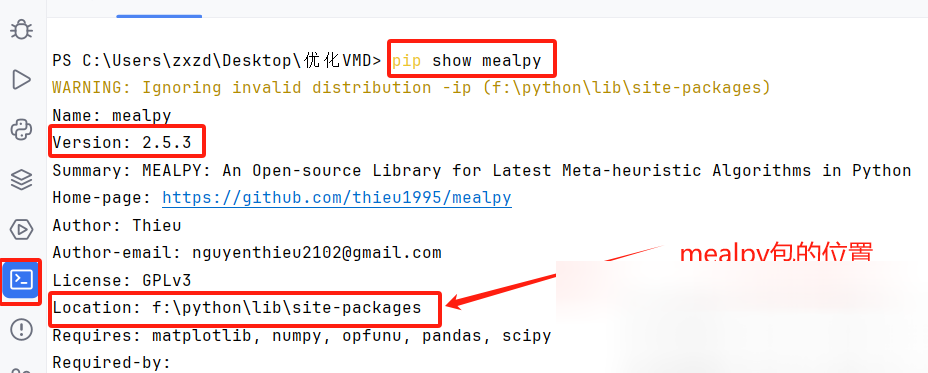
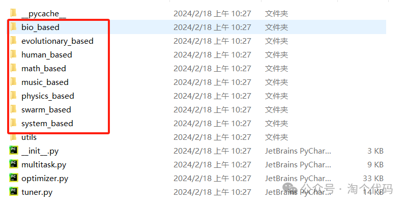
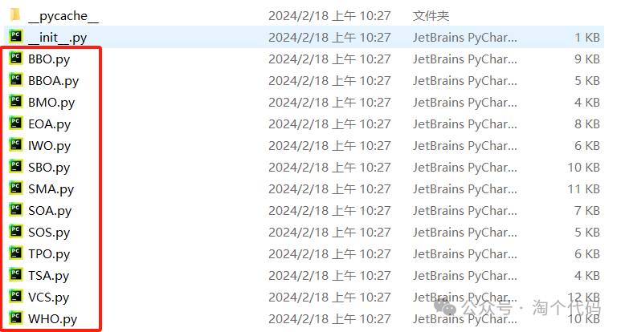
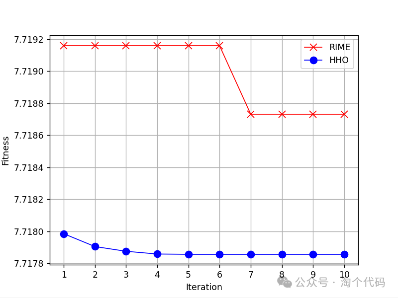
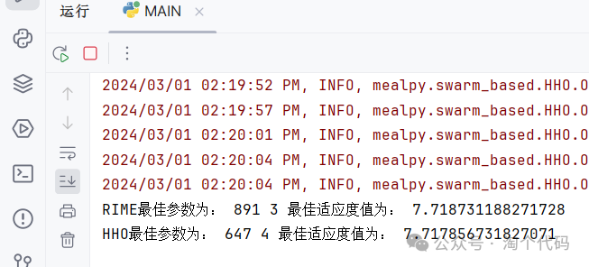
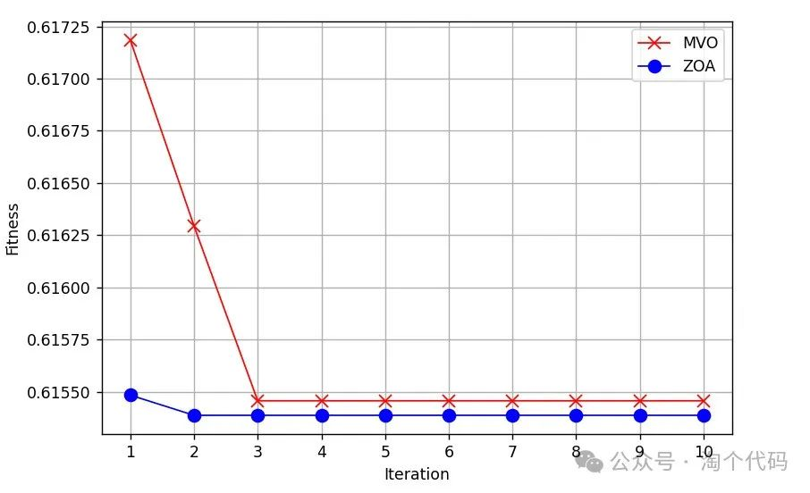
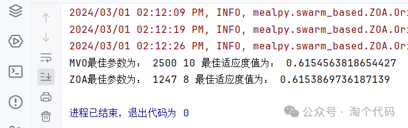
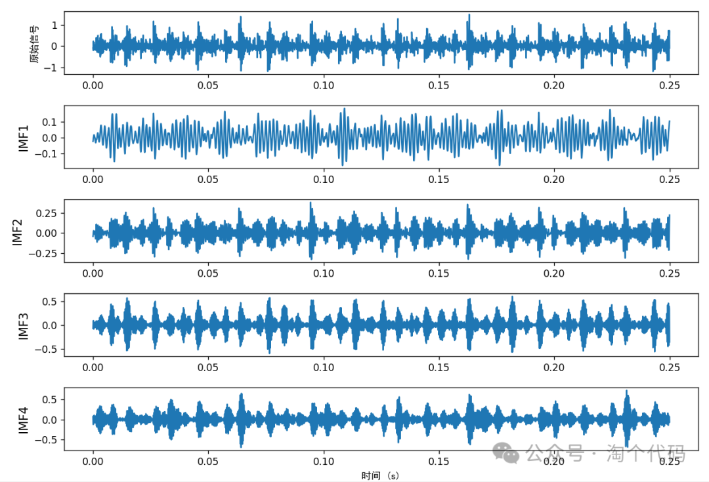
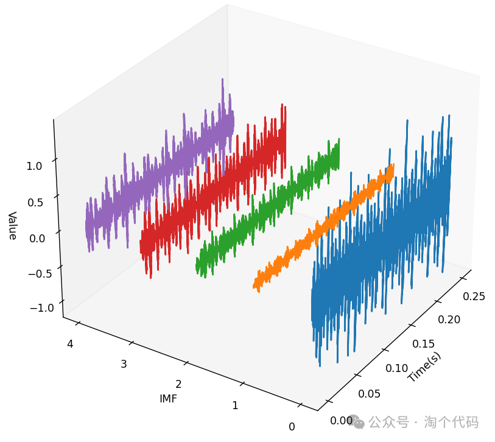
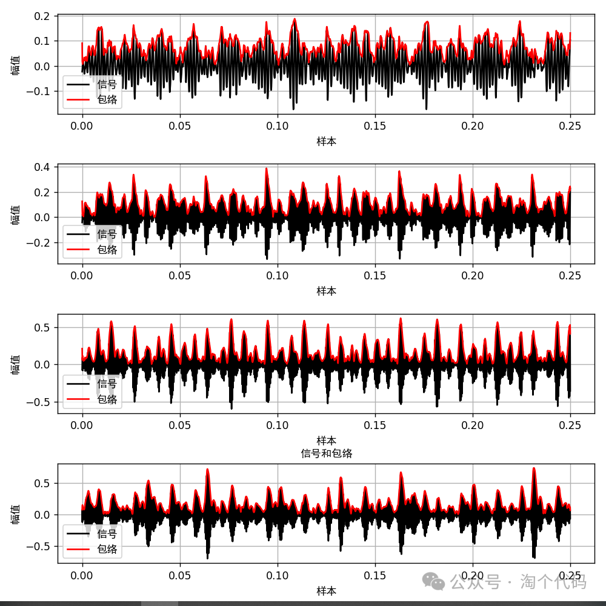
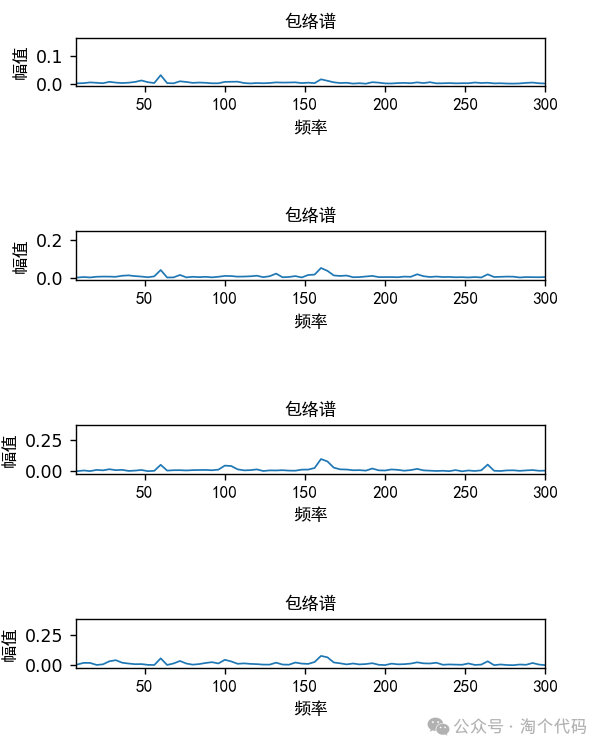
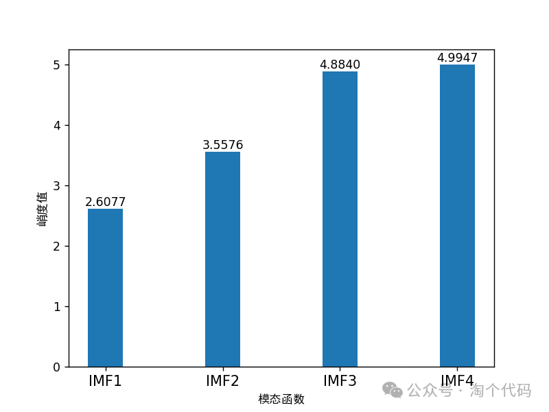
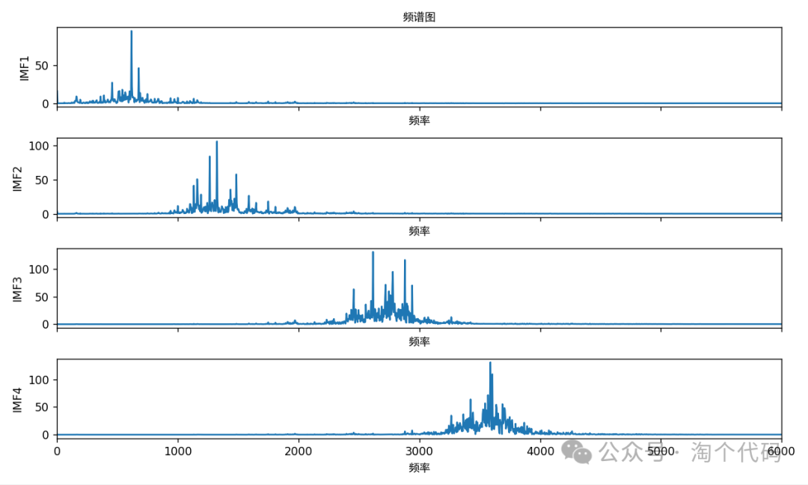
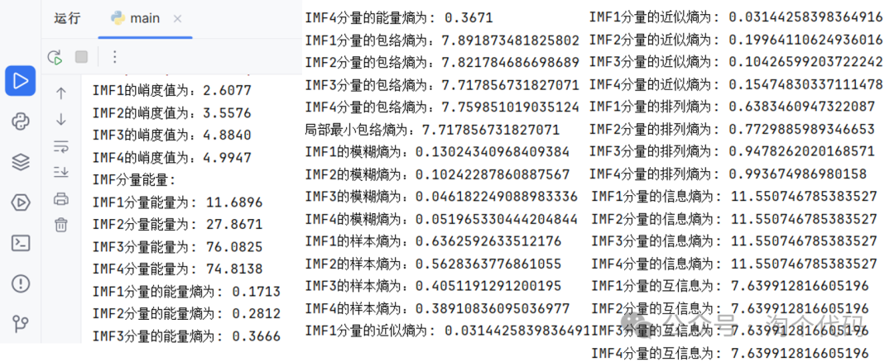

<!-- PAYMENT_BLOCK -->

## Get this dataset

- Payment link (Stripe): [Buy now](https://buy.stripe.com/3cs8yP7sY87d0vu9AB)
- Payment QR code: 

<!-- /PAYMENT_BLOCK -->
